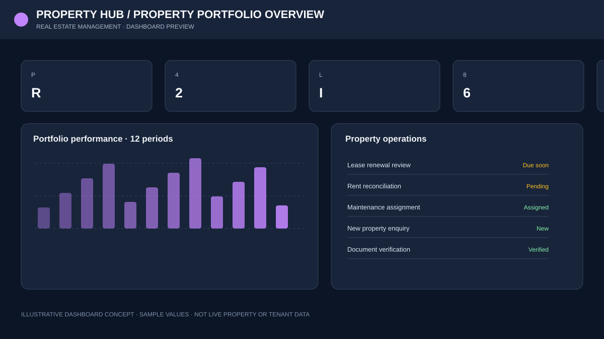
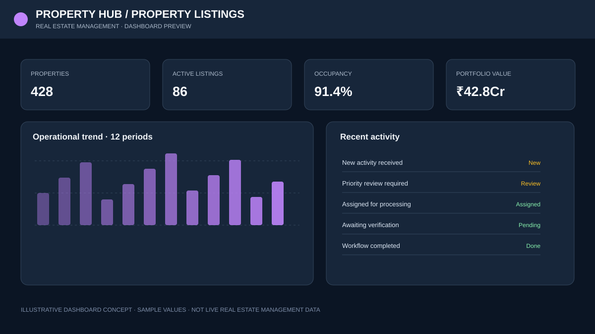
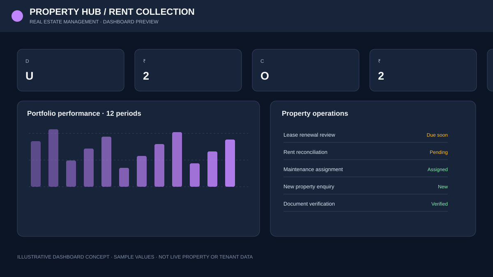
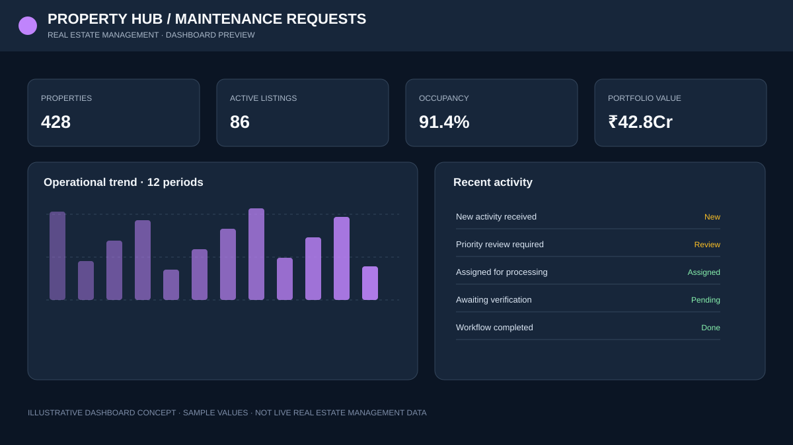
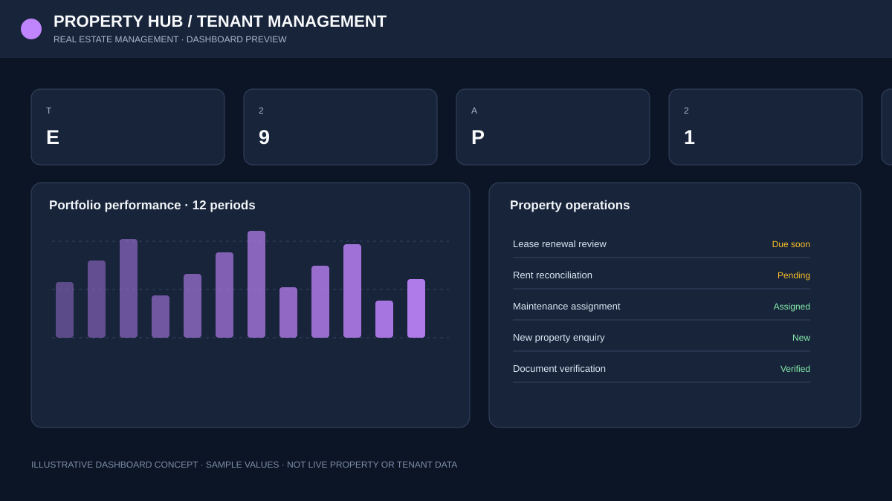
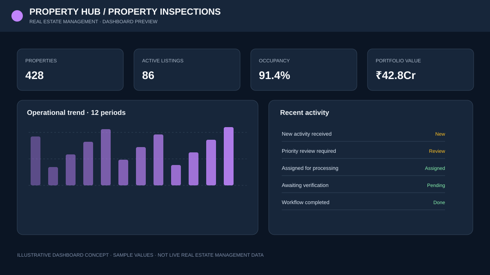
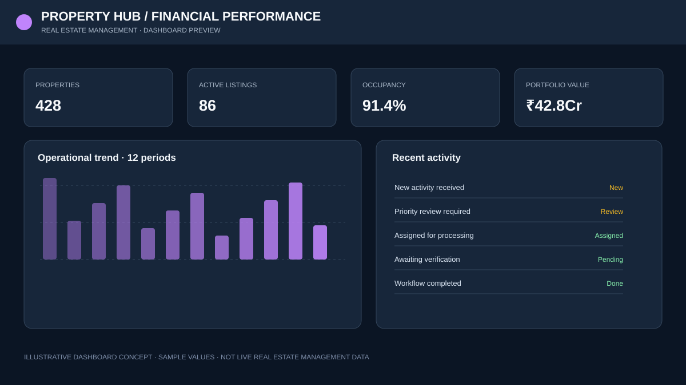
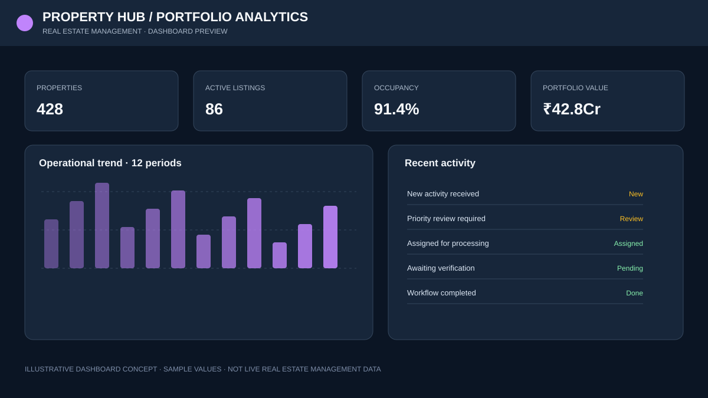

# Real Estate Management System

A full-stack property management application built with React, Vite, Express, and MongoDB. The project brings property listings and day-to-day rental operations into one interface.

## Features

The repository includes modules for:
- Property listings, galleries, and wishlists
- Tenant and user authentication
- Bookings, site visits, and lease management
- Rent tracking, expenses, and commissions
- Maintenance requests and notifications
- Reviews, tenant ratings, and messaging
- Document handling, analytics, audit records, and exports

Feature availability depends on the configured backend services and database. Use non-production data while evaluating this project.

## Technology

| Layer | Stack |
|---|---|
| Frontend | React 19, Vite, React Router, Redux Toolkit, Axios, Recharts |
| Backend | Node.js, Express 5 |
| Database | MongoDB with Mongoose |
| Authentication | JWT and password hashing |
| Email | Nodemailer |
| Documents | Multer and PDFKit |

## Repository layout

- `client/` — React frontend
- `server/` — Express API, models, routes, and database connection

## Prerequisites

- Node.js 20 or a compatible current LTS release
- npm
- MongoDB database (local or hosted)

## Local setup

### 1. Configure the backend

```bash
cd server
cp .env.example .env
npm install
```

Set real local values in `server/.env`:

| Variable | Purpose |
|---|---|
| `PORT` | API port (example: `5000`) |
| `MONGO_URI` | MongoDB connection string |
| `JWT_SECRET` | Long, random signing secret |
| `EMAIL_USER` | Email account used by the mailer |
| `EMAIL_PASS` | Email provider app password |
| `CLIENT_URL` | Frontend origin allowed by your deployment configuration |

Start the API:

```bash
npm start
```

The API root responds at `http://localhost:5000/`.

### 2. Configure the frontend

In a second terminal:

```bash
cd client
npm install
```

Create `client/.env` with:

```dotenv
VITE_API_URL=http://localhost:5000/api
```

Start the frontend:

```bash
npm run dev
```

Vite normally serves the app at `http://localhost:5173`.

## Production build

From `client/`:

```bash
npm run build
```

The generated static site is written to `client/dist`. Deploy the API and frontend separately, configure the production MongoDB URI and email credentials through your hosting provider's secret manager, and set `VITE_API_URL` to the deployed API base URL before building.

## Tests and verification

The backend includes Node.js tests for origin validation, public signup role policy, and the in-memory authentication rate limiter. Run `npm test` from `server/`. Run the frontend production build and verify authentication, property CRUD, bookings, rent, uploads, and email flows against a dedicated test database before production use.

## Security notes

- Never commit `.env` files or real credentials.
- Use a unique, high-entropy `JWT_SECRET` in each environment.
- Restrict database network access and use a least-privilege database user.
- Configure `CLIENT_URL` with comma-separated exact frontend origins; production startup rejects missing, wildcard, or malformed origin configuration.
- Public signup is restricted server-side to Tenant. Hiding privileged roles in the UI is not treated as an authorization boundary.
- API requests have a 1 MB JSON body limit, baseline security headers, structured error responses, and JWT validation restricted to HS256.
- Registration, login, and OTP endpoints have per-process in-memory throttles. These limits are not shared across multiple API instances; use a shared store such as Redis before horizontal scaling. Configure Express proxy trust only for the actual trusted reverse-proxy topology.
- Do not use real tenant or financial data in a public demo.

## Maintainer

Matiur Rahaman

---
This project is provided for learning, portfolio demonstration, and further development. Review and test all workflows before using it in a real property-management environment.

## Live Demo

**Frontend:** [Open Live Demo](https://realestate-management-system-psi.vercel.app)

> This link points to the deployed frontend. Features that depend on the API, database, email, file storage, or other external services may require the corresponding backend services and environment variables to be configured. Use test data only; this demo is not a production service.


## Dashboard Gallery

Explore 12 illustrative workspaces for property portfolios, listings, leases, rent collection, maintenance, owners and agents, tenants, bookings, inspections, finance, compliance and analytics. These are sample-data UI concepts, not live screenshots or actual tenant/financial records.

### 01. Property Portfolio Overview

Inventory, active listings, occupancy and portfolio performance.



### 02. Property Listings

Listing status, types, pricing and publication workflow.



### 03. Leasing & Tenancy

Lease lifecycle, move-ins, expirations and tenant status.


### 04. Rent Collection

Rent due, collections, arrears and payment reconciliation.



### 05. Maintenance Requests

Tickets, priority queues, vendor assignments and completion.



### 06. Owner & Agent Workspace

Owner portfolios, agent assignments, commissions and activity.


### 07. Tenant Management

Tenant profiles, occupancy history, documents and communication.



### 08. Booking & Applications

Enquiries, viewings, applications and approval stages.


### 09. Property Inspections

Schedules, condition reports, action items and follow-ups.



### 10. Financial Performance

Income, operating costs, commissions and net yield trends.



### 11. Documents & Compliance

Lease documents, identity checks, certificates and expiry alerts.


### 12. Portfolio Analytics

Occupancy, vacancy, revenue trends and property comparisons.


